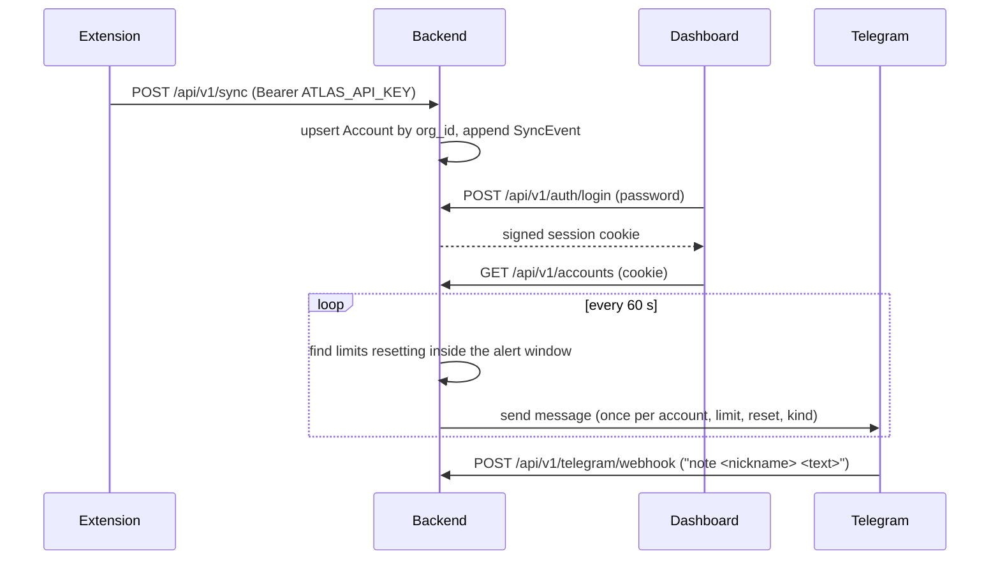

# UsageOS: developer guide

Everything you need to run UsageOS locally, change it, and send a pull request. If you only want to *use* UsageOS, read [README.md](README.md) instead.

## Contents

1. [Repository layout](#repository-layout)
2. [How the pieces talk](#how-the-pieces-talk)
3. [Prerequisites](#prerequisites)
4. [Run everything in Docker](#option-a-run-everything-in-docker)
5. [Run with hot reload](#option-b-hot-reload-development)
6. [Demo data and screenshots](#demo-data-and-screenshots)
7. [Working on the extension](#working-on-the-extension)
8. [API reference](#api-reference)
9. [Data model](#data-model)
10. [Database migrations](#database-migrations)
11. [Known rough edges](#known-rough-edges)
12. [Contributing](#contributing)
13. [License](#license)

---

## Repository layout

```
UsageOS/
├── backend/                 FastAPI + SQLAlchemy + PostgreSQL
│   ├── app/
│   │   ├── main.py          app setup, CORS, Telegram notification loops, table creation
│   │   ├── config.py        settings read from environment variables
│   │   ├── migrations.py    runs Alembic to `head` on startup (with a Postgres advisory lock)
│   │   ├── auth.py          Bearer-key auth (extension) and signed-cookie sessions (dashboard)
│   │   ├── models.py        Account, SyncEvent, AccountNote, Setting, NotificationLog
│   │   ├── schemas.py       Pydantic request/response models
│   │   ├── preferences.py   notification settings stored in the `settings` table
│   │   ├── telegram.py      send_telegram_message()
│   │   └── routers/         sync, accounts, auth, alerts, status, maintenance,
│   │                        preferences, telegram_webhook
│   └── alembic/             migrations (see Known rough edges)
├── frontend/                React 18 + Vite + TypeScript + Tailwind
│   ├── src/pages/           Dashboard, AccountDetail, Alerts, Settings, Login
│   ├── src/components/      AccountCard, Meter, HistoryChart, MaintenanceNote, ...
│   ├── src/lib/             api.ts (axios), queries.ts (React Query), usage.ts (limit maths)
│   └── nginx.conf           serves the build and proxies /api/ to the backend
├── extension/               Chromium MV3 extension (fork of lugia19/Claude-Usage-Extension)
│   ├── background.js        service worker
│   ├── bg-components/       atlasSync.js (backend sync + offline queue), claude-api.js, ...
│   ├── injections/          code injected into the claude.ai page (usage SSE watcher)
│   ├── content-components/  UI injected into claude.ai (sidebar notes, usage panel)
│   ├── options.html/js      server URL + API key + sync status
│   └── manifest_chrome.json source of truth; manifest.json is a copy
├── scripts/seed_demo.py     fictional data for screenshots and demos
├── docker-compose.yml
├── docker-compose.proxy.yml optional: attach the dashboard to an existing proxy network
└── .env.example
```

## How the pieces talk



Two kinds of auth exist on purpose:

- **Extension to backend:** `Authorization: Bearer <ATLAS_API_KEY>` on `/sync`.
- **Dashboard to backend:** a signed, `HttpOnly` session cookie obtained from `/auth/login` (password is `DASHBOARD_PASSWORD`, falling back to `ATLAS_API_KEY`). Every dashboard endpoint also accepts the Bearer key, which is handy for `curl`.

## Prerequisites

| Tool | Version |
|---|---|
| Docker + Compose v2 | recent |
| Node.js | 20 |
| Python | 3.12 |
| PostgreSQL | 16 (Docker provides it) |
| Chromium-based browser | for the extension |

## Option A: run everything in Docker

```bash
git clone https://github.com/YRB19/UsageOS.git
cd UsageOS
cp .env.example .env        # fill in POSTGRES_PASSWORD and ATLAS_API_KEY
docker compose up -d --build
```

Dashboard: <http://localhost:3000>. API docs (Swagger): <http://localhost:8000/docs>.

After **any** code change rebuild with `docker compose up -d --build <service>`. `docker compose restart` reuses the old image.

```bash
docker compose logs -f backend
docker compose exec postgres psql -U atlas -d atlas
```

## Option B: hot reload development

Run Postgres in Docker and the two apps on your machine.

**1. Database**

```bash
docker compose up -d postgres      # listens on 127.0.0.1:5432
```

**2. Backend** (terminal 1)

```bash
cd backend
python3 -m venv .venv && source .venv/bin/activate
pip install -r requirements.txt

export DATABASE_URL=postgresql://atlas:<POSTGRES_PASSWORD>@localhost:5432/atlas
export ATLAS_API_KEY=dev-key
export DASHBOARD_PASSWORD=dev

uvicorn app.main:app --reload --port 8000
```

Migrations run automatically on startup. Note the host is `localhost` here, not `postgres`.

**3. Frontend** (terminal 2)

```bash
cd frontend
npm install
npm run dev
```

Vite serves on <http://localhost:3000> and proxies `/api` to `localhost:8000`. If the full Docker stack is also running, it already uses port 3000: stop its frontend (`docker compose stop frontend`) or set `USAGEOS_PORT=8080` in `.env`.

**Type-check and build**

```bash
npm run build      # runs tsc, then vite build
```

## Demo data and screenshots

`scripts/seed_demo.py` fills the database with five fictional accounts (different tiers, one near its limit, one fully capped), a week of usage history, past alerts, notes and a maintenance note. It is deterministic, so every run produces the same picture.

> Only run it against a local or throwaway database, never your real one. Demo rows are tagged (`org_id` starts with `demo-org-`) and `--reset` removes only those.

```bash
# Docker stack
docker compose exec -T backend python - < scripts/seed_demo.py            # add demo data
docker compose exec -T backend python - --fresh < scripts/seed_demo.py    # rebuild it (fresh timestamps)
docker compose exec -T backend python - --reset < scripts/seed_demo.py    # remove it

# Local backend (DATABASE_URL set, venv active)
cd backend && python ../scripts/seed_demo.py --fresh
```

History is generated relative to "now", so run `--fresh` right before taking screenshots. Accounts only look "live" if their last sync is under two hours old.

Telegram is intentionally not linked on demo accounts so the scheduler never tries to message a made-up chat ID.

### Screenshot checklist

Save into `docs/screenshots/` using these names (the README references them):

| File | What to capture |
|---|---|
| `hero.png` | Dashboard, the version you like best (dark or light) |
| `dashboard-dark.png`, `dashboard-light.png` | Dashboard in each theme |
| `account-detail.png` | Open the "Research" or "Studio" account |
| `alerts.png` | Alerts page |
| `settings.png` | Settings page |
| `mobile.png` | Dashboard at about 390 x 844 (browser devtools device mode) |
| `extension-sidebar.png` | The UsageOS notes box on claude.ai (use a throwaway account, crop out anything private) |
| `extension-options.png` | Extension options page, with the API key field empty or masked |

Tips: use a window around 1440 x 900, hide bookmarks and other tabs, and check that no real email addresses or keys are visible before committing. Compress PNGs (for example with <https://squoosh.app>) to keep the repository small.

## Working on the extension

1. `chrome://extensions`, **Developer mode**, **Load unpacked**, select `extension/`.
2. After every code change press the reload icon on the extension card, then refresh your claude.ai tabs.
3. Errors: the **Errors** button on the extension card (content scripts), the "service worker" link (background script console), and the sync status line on the Options page.

Rules that have caused real bugs:

- `extension/manifest.json` must be an exact copy of `manifest_chrome.json`. After editing the latter: `cp extension/manifest_chrome.json extension/manifest.json`.
- `content-components/ui_dataclasses.js` is **generated** from `shared/dataclasses.js`. After changing the source: `cd extension && node scripts/build-dataclasses.js`.
- Never reference a file from a content script unless it exists, or Chrome refuses to load the whole extension.
- `atlasSync.js` must never cache failed lookups (for example an unresolved email), or one failure sticks for a day.
- `manifest_firefox.json` ships but Firefox is not a tested target.

`extension/README.md` lists what differs from upstream.

## API reference

Base path `/api/v1`. "Key" means `Authorization: Bearer <ATLAS_API_KEY>`. "Dashboard" means session cookie **or** key.

| Method | Path | Auth | Purpose |
|---|---|---|---|
| GET | `/health` | none | Liveness check |
| POST | `/sync` | key | Extension posts a usage snapshot |
| GET | `/sync/{org_id}` | key | Recent snapshots for an organization |
| POST | `/auth/login` | none | Exchange the dashboard password for a session cookie (rate limited) |
| POST | `/auth/logout` | none | Clear the session cookie |
| GET | `/auth/me` | dashboard | Is the session valid? |
| GET | `/accounts` | dashboard | All accounts with latest limits and notes |
| GET / PATCH | `/accounts/{id}` | dashboard | Read, or update `nickname`, `color`, `telegram_chat_id` |
| GET | `/accounts/{id}/sync-history` | dashboard | History (`limit`, `since`; `limit=0` means all) |
| GET / PUT | `/accounts/{id}/note` | dashboard | Per-account note (`{"content": "..."}`) |
| POST | `/accounts/{id}/avatar` | dashboard | Upload png/jpeg/webp, 2 MB max |
| GET | `/accounts/{id}/avatar` | none | Serve the avatar image |
| GET / PATCH | `/settings` | dashboard | Notification preferences |
| GET | `/alerts`, `/alerts/stats` | dashboard | Sent notifications and counts (24 h, 30 d) |
| GET | `/status/activity` | dashboard | Syncs per hour (`hours`, up to 168) |
| GET / PUT | `/maintenance/note` | dashboard | The shared sticky note |
| POST | `/telegram/webhook` | secret header | Called by Telegram; must send `X-Telegram-Bot-Api-Secret-Token` equal to `TELEGRAM_WEBHOOK_SECRET`, otherwise 403 |

Example sync payload:

```json
{
  "provider": "claude",
  "email": "me@example.com",
  "org_id": "org-uuid",
  "subscription_tier": "claude_max_5x",
  "timestamp": "2026-11-13T12:00:00Z",
  "limits": {
    "session":       { "usage_pct": 42.0, "resets_at": "2026-11-13T15:00:00Z" },
    "weekly":        { "usage_pct": 61.0, "resets_at": "2026-11-17T09:00:00Z" },
    "sonnet_weekly": null,
    "opus_weekly":   null
  }
}
```

```bash
curl -s http://localhost:8000/api/v1/accounts -H "Authorization: Bearer $ATLAS_API_KEY"
```

## Data model

```
accounts           id, provider, email, org_id (unique), nickname, color,
                   telegram_chat_id, subscription_tier, avatar_url, created_at, updated_at
sync_events        id, account_id -> accounts, org_id, email, subscription_tier,
                   limits (JSONB), timestamp
account_notes      account_id -> accounts (unique), content, updated_at
settings           key, value, updated_at      (notification prefs, maintenance note)
notification_log   id, account_id -> accounts, limit_type, resets_at,
                   notification_type ('pre_reset' | 'reset'), notified_at
                   unique on (account, limit_type, resets_at, notification_type)
```

The unique index on `notification_log` is what guarantees one alert per account, limit, reset and kind, even with two uvicorn workers.

## Database migrations

The schema is managed by Alembic (`backend/alembic/versions/`). `app/migrations.py` upgrades to `head` every time the backend starts, so a fresh database gets everything and an existing one gets any new columns. A Postgres advisory lock stops the two uvicorn workers from migrating at the same time.

To change the schema:

```bash
cd backend
alembic revision -m "add something"      # then edit the new file in alembic/versions/
```

Keep every migration **idempotent**: check with `sa.inspect(op.get_bind())` whether a table, column or index exists before creating or dropping it. Databases created by early UsageOS versions have no `alembic_version` table and already contain most of the schema, so the whole chain replays over them and must not fail. Update `app/models.py` to match.

## Known rough edges

Real, current issues and good places to contribute.

1. **No automated tests.** `pyproject.toml` has a `dev` extra with pytest, but there are no tests yet. Sync parsing, limit maths (`frontend/src/lib/usage.ts`), the migrations (empty database, old database, repeat run) and the notification loop are the best first targets.
2. The production frontend bundle is over 500 kB; code-splitting would help.
3. `manifest_firefox.json` ships, but Firefox is not a tested target.
4. The alert loops run inside each uvicorn worker. The unique index on `notification_log` keeps alerts from duplicating, but a single scheduler would be cleaner.

## Contributing

1. Fork the repository and create a branch: `git checkout -b feat/short-description`.
2. Make your change and make sure `npm run build` passes and the stack still starts.
3. Use [Conventional Commits](https://www.conventionalcommits.org) for messages, as the history does (`feat(frontend): ...`, `fix(extension): ...`, `docs: ...`).
4. Open a pull request describing what changed and why. Screenshots help for UI changes.
5. Never commit secrets, `.env` files or real account data.

By contributing you agree your work is released under the same license as the project (GPL-3.0).

Found a security problem? Please do not open a public issue. See [SECURITY.md](SECURITY.md).

## License

GPL-3.0. See [LICENSE](LICENSE). The extension is derived from [lugia19/Claude-Usage-Extension](https://github.com/lugia19/Claude-Usage-Extension) (GPL-3.0). Keep that attribution, and keep modified files clearly marked as modified, when you redistribute.
