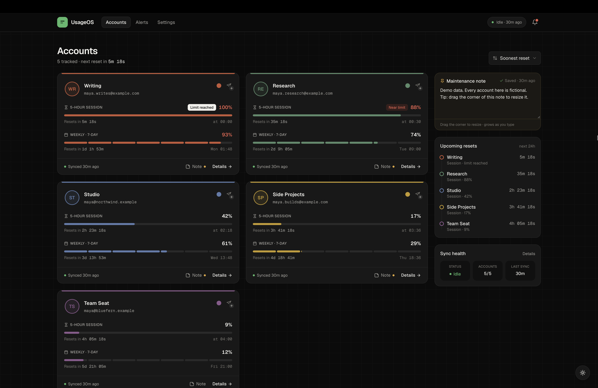
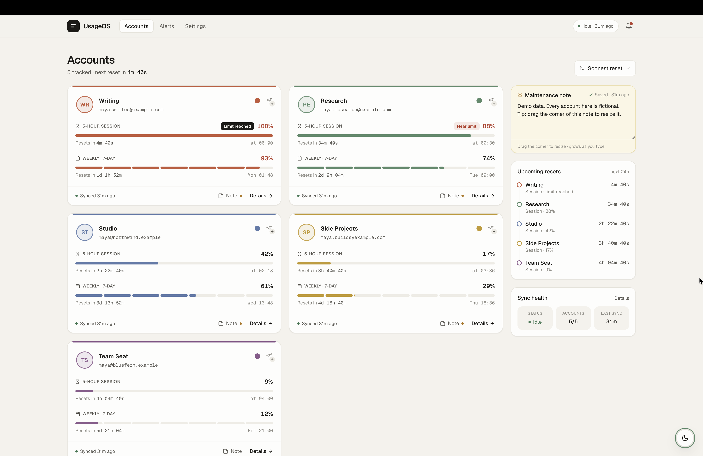
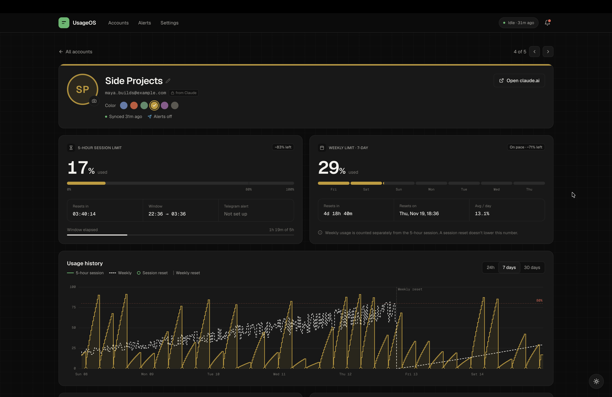
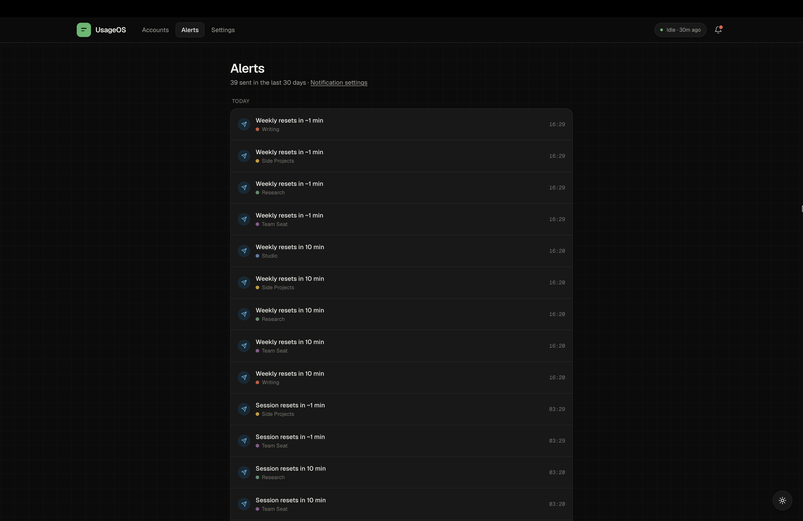
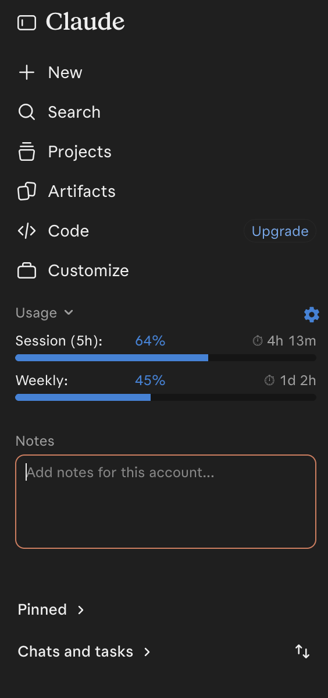
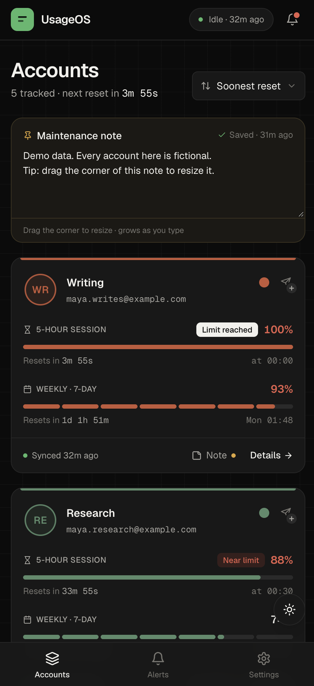
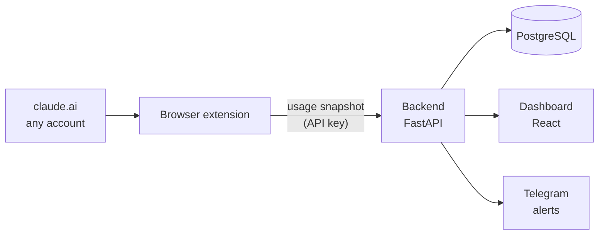

<div align="center">

# UsageOS

**One dashboard for every Claude.ai account you use.**

Self-hosted. Usage history is stored on your own server.

[](LICENSE)




</div>

---

## Why this exists

Claude's built-in usage indicator only shows the account you are logged into right now. If you use several accounts (personal, work, one per project), you end up switching logins just to find out how much you have left.

UsageOS fixes that. A small browser extension quietly records usage from every account you use, and a web dashboard shows all of them side by side.

## Features

- **Every account on one screen.** Session and weekly usage, Sonnet/Opus weekly limits where they apply, subscription tier, and a live countdown to each reset.
- **Account detail and history.** A usage chart per account so you can see how you actually spend your limits.
- **Nicknames, colors, avatars and notes** for each account. Notes are also editable from the claude.ai sidebar.
- **Telegram alerts** shortly before a limit resets (and again right at the reset), plus a bot you can message to add notes.
- **Alerts log** showing every notification that was sent.
- **Light and dark themes**, and a layout that works on your phone.
- **Self-hosted and password protected.** The extension syncs usage to the server you configure. Telegram alerts are optional.

### Screenshots

| Dashboard (dark) | Dashboard (light) |
|---|---|
|  |  |

| Account detail | Alerts |
|---|---|
|  |  |

| Inside claude.ai (sidebar) | Mobile |
|---|---|
|  |  |

> All screenshots use fictional demo data.

---

## How it works



1. The **extension** reads usage, limits and reset times from claude.ai and works out which account they belong to.
2. It **syncs** a snapshot to your backend after each message, every few minutes while a claude.ai tab is open, and when you open the popup. If your server is offline, snapshots are queued and sent later.
3. The **dashboard** shows the latest state of every account, plus history.
4. If you set up Telegram, a background job messages you shortly before limits reset.

The extension is a fork of [lugia19/Claude-Usage-Extension](https://github.com/lugia19/Claude-Usage-Extension). See [Credits](#credits-and-license).

---

## Quick start

You need: **Docker** with Docker Compose, a **Chromium-based browser** (Chrome, Brave, Edge), and a machine that stays on if you want accounts to sync around the clock (a home server, a VPS, or just your own computer).

### 1. Get the code and configure it

```bash
git clone https://github.com/YRB19/UsageOS.git
cd UsageOS
cp .env.example .env
```

Open `.env` and set:

| Variable | What to put |
|---|---|
| `POSTGRES_PASSWORD` | A password for the database. Letters and numbers only. `openssl rand -hex 16` makes a good one. |
| `SERVER_API_KEY` | A long random secret shared with the extension. `openssl rand -hex 32` |
| `DASHBOARD_PASSWORD` | The password you type to open the dashboard. Leave empty to reuse `SERVER_API_KEY`. |
| `TELEGRAM_BOT_TOKEN` | Optional. Only needed for Telegram alerts (see below). |
| `TELEGRAM_WEBHOOK_SECRET` | Optional. Only for Telegram. `openssl rand -hex 24` |

### 2. Start it

```bash
docker compose up -d --build
```

Open <http://localhost:3000> and sign in with your dashboard password. You will see an empty dashboard until the extension has synced an account.

Quick health check: `curl http://localhost:3000/api/v1/health` should return `{"status":"ok"}`.

### 3. Install the extension

1. Open `chrome://extensions` and turn on **Developer mode**.
2. Click **Load unpacked** and choose the `extension/` folder from this repository.
3. Click the UsageOS icon, then **Server**. Enter:
   - **Server URL**: `http://localhost:3000` (or your own domain if you set one up, with no trailing slash)
   - **API Key**: the `SERVER_API_KEY` from your `.env`
4. Press **Save** and accept Chrome's request to let the extension reach your server, then press **Test Connection**.
5. Open claude.ai, sign in to an account and send a message. That account shows up on your dashboard within moments.

Repeat step 5 for every Claude account (use a separate browser profile for each account, with the extension installed in each).

### 4. Want to reach it from your phone or other devices?

Put it behind HTTPS with a domain. Any reverse proxy works; with Caddy it is two lines:

```
usageos.example.com {
    reverse_proxy localhost:3000
}
```

Then use that address as the **Server URL** in the extension. HTTPS is required for Telegram alerts, and strongly recommended for anything reachable from the internet.

Already run a proxy in its own Docker network? Use the override file:
`docker compose -f docker-compose.yml -f docker-compose.proxy.yml up -d --build`

### 5. Optional: Telegram alerts

1. In Telegram, message [@BotFather](https://t.me/BotFather), create a bot, and put its token in `.env` as `TELEGRAM_BOT_TOKEN`. Also set `TELEGRAM_WEBHOOK_SECRET` to a random string (`openssl rand -hex 24`).
2. Restart the backend: `docker compose up -d --build backend`
3. Tell Telegram where to send messages (needs your public HTTPS address). The secret must be the same one as in `.env`:
   ```bash
   curl -s "https://api.telegram.org/bot<YOUR_TOKEN>/setWebhook" \
     -d "url=https://usageos.example.com/api/v1/telegram/webhook" \
     -d "secret_token=<YOUR_WEBHOOK_SECRET>"
   ```
   It should answer `{"ok":true,...}`. Without the secret the backend refuses every webhook call, which keeps strangers from posting fake commands.
4. Send `/start` to your bot. It replies with your chat ID.
5. In the dashboard, open an account and paste the chat ID into its Telegram field. Or set a default chat ID in **Settings** so every new account uses it.

Bot commands:

| Message | What it does |
|---|---|
| `/start` or `id` | Replies with your chat ID |
| `note <nickname> <text>` | Saves a note on the matching account |

You choose how many minutes before a reset you are alerted, and which limits notify you, in **Settings**.

---

## Updating

```bash
git pull
docker compose up -d --build
```

Database changes are applied automatically when the backend starts, and your data is kept.

`docker compose restart` is not enough. It reuses the old build.

## Troubleshooting

| Problem | Fix |
|---|---|
| Dashboard is empty | Nothing has synced yet. Send a message on claude.ai while the extension is installed and configured. |
| Extension: "API key rejected" | The key must match `SERVER_API_KEY` exactly. Fix it in the extension's Options page. |
| Nothing syncs | Open the extension's Options page and read the sync status line. Press **Save** again so Chrome can grant access to your server, then **Test Connection**. |
| An account shows "Unknown" as its email | The email could not be read for that account (common with Team or custom-named organizations). Everything else, including its nickname, still works. |
| "Could not load manifest" when loading the extension | Make sure you selected the `extension/` folder itself, not the repository root. |
| "Receiving end does not exist" or "context invalidated" | Reload the extension in `chrome://extensions`, then refresh your claude.ai tabs. |
| Telegram alerts never arrive | Check that the webhook call returned `{"ok":true}` and used the same secret as `.env`, that a chat ID is saved on the account, and that alerts for that limit type are on in Settings. |
| `docker compose up` complains about a missing variable | Fill in `POSTGRES_PASSWORD` and `SERVER_API_KEY` in `.env`. |
| Port 3000 is taken | Set `USAGEOS_PORT=3001` (or any free port) in `.env`. |

Still stuck? [Open an issue](https://github.com/YRB19/UsageOS/issues) and include what the extension's Options page says.

## Privacy and security

- Usage snapshots include limits, reset times, your organization ID, and your email and subscription tier when available. The extension sends these snapshots to the UsageOS server you configure. Snapshots exclude conversation text and attachments. See [`extension/PRIVACY.md`](extension/PRIVACY.md) for optional Anthropic token counting and Telegram behavior.
- Treat `SERVER_API_KEY`, `DASHBOARD_PASSWORD` and `TELEGRAM_BOT_TOKEN` like passwords. Never commit your `.env` file.
- If a secret leaks: change it in `.env`, recreate the containers (`docker compose up -d`), and update the extension's Options page. For the bot token, send `/revoke` to @BotFather.
- Expose UsageOS to the internet only over HTTPS.

## For developers

See the **[developer guide](README-dev.md)** to run and change the code, or **[CONTRIBUTING.md](CONTRIBUTING.md)** to report a bug or send your first pull request.

## Credits and license

UsageOS is free software, licensed under the **GNU General Public License v3.0**. See [LICENSE](LICENSE).

The browser extension is a modified version of [**Claude Usage Tracker** by lugia19](https://github.com/lugia19/Claude-Usage-Extension) (version 6.1.4, GPL-3.0). Thank you to the original author. This fork adds multi-account syncing to a self-hosted backend, a local dashboard and sidebar notes, and removes the original's donation and promotional elements. The backend and web dashboard are original to this project.

UsageOS is an independent project and is not affiliated with or endorsed by Anthropic. "Claude" is a trademark of Anthropic.
